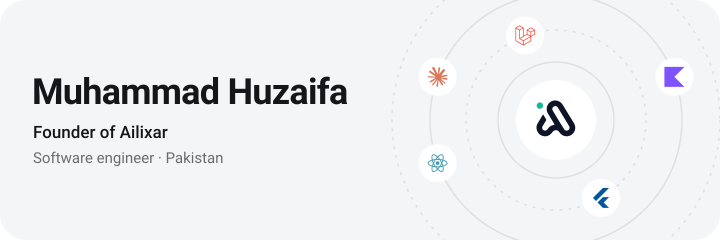
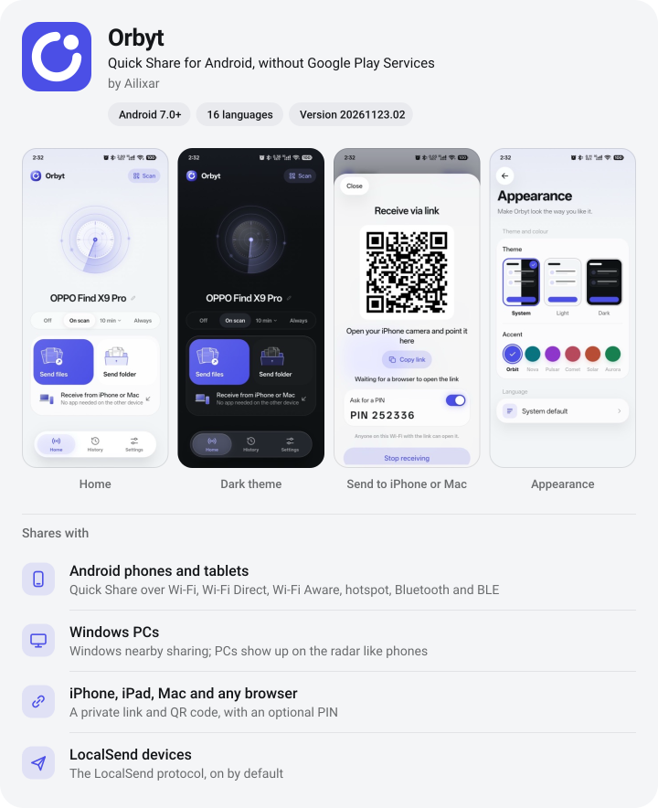
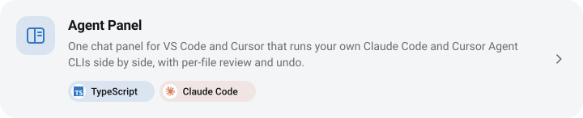
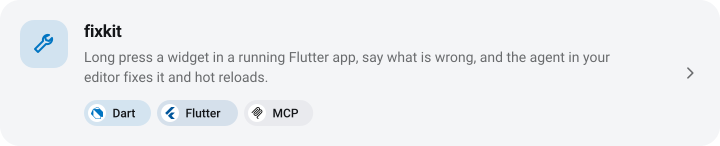
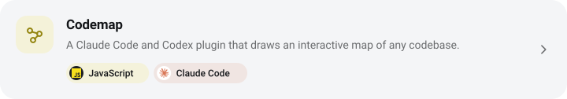
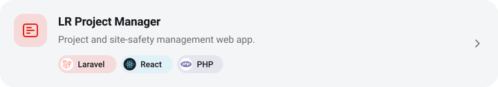
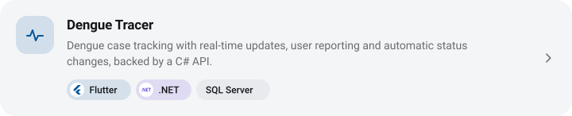
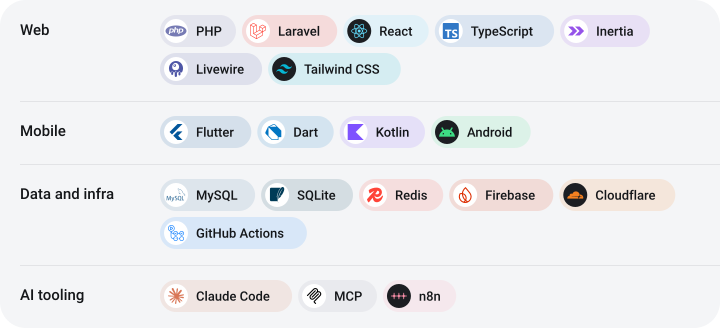

<picture><source media="(prefers-color-scheme: dark)" srcset="assets/v10/banner-dark.svg"></picture>

I design, build and ship complete products. At [Ailixar](https://ailixar.com) we make business software for clients (POS, CRM, ERP, warehouse and finance systems) and our own apps for everyone else: Laravel and React on the web, Flutter and native Kotlin on mobile, and tools that make AI coding agents faster to work with.

  <a href="https://ailixar.com"><picture><source media="(prefers-color-scheme: dark)" srcset="assets/v10/contact-site-dark.svg"></picture></a>
  <a href="https://www.linkedin.com/in/huzaifa-se/"><picture><source media="(prefers-color-scheme: dark)" srcset="assets/v10/contact-linkedin-dark.svg"></picture></a>
  <a href="mailto:huzaifanawaz367@gmail.com"><picture><source media="(prefers-color-scheme: dark)" srcset="assets/v10/contact-email-dark.svg"></picture></a>
  <a href="https://wa.me/923203608044"><picture><source media="(prefers-color-scheme: dark)" srcset="assets/v10/contact-whatsapp-dark.svg"></picture></a>

<picture><source media="(prefers-color-scheme: dark)" srcset="assets/v10/title-featured-dark.svg"></picture>

<a href="https://ailixar.com"><picture><source media="(prefers-color-scheme: dark)" srcset="assets/v10/orbyt-listing-dark.svg"></picture></a>

<picture><source media="(prefers-color-scheme: dark)" srcset="assets/v10/title-open-source-dark.svg"></picture>

<a href="https://github.com/Huzaifa-367/agent-panel"><picture><source media="(prefers-color-scheme: dark)" srcset="assets/v10/project-agent-panel-dark.svg"></picture></a>
<a href="https://github.com/Huzaifa-367/Fixkit-Pckg"><picture><source media="(prefers-color-scheme: dark)" srcset="assets/v10/project-fixkit-dark.svg"></picture></a>
<a href="https://github.com/Huzaifa-367/Codemap"><picture><source media="(prefers-color-scheme: dark)" srcset="assets/v10/project-codemap-dark.svg"></picture></a>
<a href="https://github.com/Huzaifa-367/LR-ProjectManager"><picture><source media="(prefers-color-scheme: dark)" srcset="assets/v10/project-lr-project-manager-dark.svg"></picture></a>
<a href="https://github.com/Huzaifa-367/Dengue-Tracer"><picture><source media="(prefers-color-scheme: dark)" srcset="assets/v10/project-dengue-tracer-dark.svg"></picture></a>

<picture><source media="(prefers-color-scheme: dark)" srcset="assets/v10/title-stack-title-dark.svg"></picture>

<picture><source media="(prefers-color-scheme: dark)" srcset="assets/v10/stack-dark.svg"></picture>

<a href="https://ailixar.com"><picture><source media="(prefers-color-scheme: dark)" srcset="assets/v10/cta-dark.svg"></picture></a>
